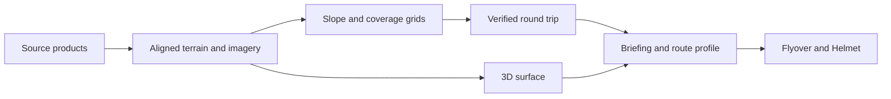

# Columbia Hills Development Plan

**Project** Mars Traverse Planner  
**First site** Home Plate, Columbia Hills, Gusev Crater  
**Mission** Plan a proposed walk from a rover drop-off to a science stop near Gertrude Weise and back.

## 1. What we are building

Build one versioned Columbia Hills dataset and prove that it can generate a reproducible round trip from real Mars elevation data. Start with a small area around Home Plate. Use a matching orbital image to show the terrain and Spirit’s observation to explain the science stop. Add the planning and rehearsal features once the underlying map and route agree.

Gertrude Weise is a silica-rich soil exposure east of Home Plate. Spirit’s observations support a science question about past water and potentially habitable environments. The rover observation and the proposed crew walk are separate records. [NASA Gertrude Weise observation][silica] · [Spirit mission study][spirit-study]

The current HTML prototype is a reference for interaction and layout. Its generated elevations, distances, temperatures, radiation, and alert thresholds are simulation inputs. The first release uses one area, one proposed drop-off, and one science destination. The seven-site picker and multi-site publishing stay in the project backlog.

## 2. Development order

| Phase | Work | Evidence required to finish |
|---|---|---|
| **0. Set up** | Create the project structure, pin tooling, and record the data products. | A fresh checkout can run the build and test commands. Source IDs and versions are recorded. |
| **1. Establish coverage** | Download the elevation model, matching image, and science sources. Register the mission area and check overlap. | A review map marks Home Plate, the supported science location or uncertainty area, candidate staging ground, and the shared data footprint. |
| **2. Build the terrain** | Prepare a common grid, derive slopes, and export the 3D surface and coverage mask. | A browser scene matches the reference map. The analytic terrain passes elevation, slope, and coordinate checks. |
| **3. Prove routing** | Build a testable graph, select valid endpoints, and generate a round trip. | A saved real-data route passes independent checks and ends at its departure point. The engine can explain route failures. |
| **4. Add planning tools · complete** | Make the start movable, compare route options, and link the route profile to the map. | Worker searches, full staging checks, both-leg scrubbing and warning inspection implemented; see the completion record. |
| **5. Add rehearsal and release · complete** | Connect the cinematic flyover and Helmet view, then test and package the site. | All views use the same route. The demo runs end to end on desktop and mobile. |



## 3. Phase 0 — Set up the project

**Status: complete on this machine, 14 November 2026.** See [the completion record](docs/phase-0-completion.md) for versions and verification evidence. The original 3D fixture remains synthetic; the separate Phase 1 coverage review uses real HiRISE sources.

Use a static TypeScript web app with Vite and Three.js. Prepare the geospatial assets offline with Python, GDAL, and NumPy. Keep routing and route sampling in plain TypeScript so they can run in tests before the browser UI exists. Move search into a Web Worker when wiring it to the UI. Record the Bun, Vite, Three.js, TypeScript, Python, GDAL, and NumPy versions and retain the generated Bun lockfile. [Vite setup][vite] · [Three.js documentation][three] · [GDAL documentation][gdal-info]

```text
config/columbia-hills/        Source inventory, crop bounds, planning parameters
data/raw/columbia-hills/      Original downloads and labels, local only
data/work/columbia-hills/     GeoTIFFs, validation maps, and intermediate outputs
tools/                       Data preparation and package validation
public/sites/columbia-hills/  Versioned browser-ready terrain, imagery, and metadata
src/terrain/                 Asset loading, coordinate transforms, and 3D surface
src/routing/                 Path search, route metrics, profile, and worker
src/mission/                 Selected route, rover, target, and distance cursor
src/views/                   Briefing, profile, flyover, and Helmet
tests/                       Small synthetic grids and a checked Columbia Hills route
```

Use the local Bun-managed TypeScript starter in `/home/owais/MAREKH`. Install its pinned dependencies with `bun install --frozen-lockfile`. Vite builds the app, Three.js renders the scene, and Bun runs the tests. Use `bun run test` and `bun run build` to verify the setup. Add separate commands for data preparation, package validation, and route tests. Keep large raw files outside Git. Record download URLs and SHA-256 checksums so a teammate can reproduce the site.

**Done when** the starter builds and one synthetic raster fixture can run through the local preparation and test setup.

## 4. Phase 1 — Establish the site and acquire data

**Status: complete on this machine, 14 November 2026.** See [the review map](docs/phase-1-review.html) and [the completion record](docs/phase-1-completion.md). The real crop and shared footprint are verified; staging and approach geometry remain provisional. Open the orthophoto through its detached `.LBL`, because the JP2 embedded georeferencing differs from the intended DTM grid. The Phase 3 endpoint decisions are recorded in the separate `routes-v1` package; this Phase 1 evidence remains unchanged.

| Input | Source | What it provides |
|---|---|---|
| Elevation | [HiRISE product catalogue][hirise], `DTEEC_001513_1655_001777_1650_U01.IMG` | A digital terrain model, listed at about 1.01 m per pixel. It supplies elevation for the 3D surface and slope calculation. |
| Optical image | [HiRISE product directory][products], `PSP_001513_1655_RED_C_01_ORTHO.JP2` and matching `.LBL` | The initial map-aligned texture. This is the HiRISE red-band product. Keep its source appearance or label any later color treatment. |
| Science evidence and location | [NASA photojournal][silica], [Spirit tracks near Home Plate][spirit-tracks], and [Spirit mission study][spirit-study] | The silica observation, rover traverse context, and maps to help register the science stop. The study reports the local composition and mineral evidence. |
| Operating conditions | [Odyssey THEMIS infrared products][themis] and [Curiosity RAD context][rad] | Optional follow-up data. THEMIS coverage and observation timing need a site check. Curiosity RAD measurements describe conditions at its own location and time. |

1. Download the listed elevation product and imagery pair from the HiRISE directory. Save the image label with its JP2. Record product IDs, original filenames, source URLs, credits, acquisition metadata where available, and checksums.
2. Inspect the rasters with `gdalinfo -json`. Record the actual Mars CRS and axis conventions, geotransform, raster dimensions, horizontal and vertical units, any scale or offset, and NoData or masks. Verify the imagery’s transform against its label. Some GDAL versions interpret HiRISE label fields differently. [HiRISE format instructions][hirise-howto] · [GDAL PDS driver][gdal-pds]
3. Load the terrain and image together in a GIS. Use Spirit’s maps and visible landmarks to locate Home Plate and the supported position or area for Gertrude Weise. The photo anchors the observation. Use a registered map or traverse record for position and record the uncertainty.
4. Start with an approximately **1 km by 1 km** crop as a planning assumption. Adjust it around the overlapping valid data so it includes the science area, a possible staging patch, and room for alternate paths. Save the final bounds in the input CRS. Review the crop on a hillshade and an optical image.
5. Store the **science evidence location** and the **walkable approach waypoint** separately. If the observation is only located to an area, draw that area and place the proposed walk endpoint at a defensible approach within or beside it. Save the justification and source.

The first dataset can be downloaded with these commands from the project root. Compare the downloaded products with the archive listing and keep the generated checksum file with the source inventory. [HiRISE product directory][products]

```bash
raw=data/raw/columbia-hills
base=https://www.uahirise.org/PDS/DTM/PSP/ORB_001500_001599/PSP_001513_1655_PSP_001777_1650
mkdir -p "$raw" data/work/columbia-hills config/columbia-hills
for product in DTEEC_001513_1655_001777_1650_U01.IMG \
  PSP_001513_1655_RED_C_01_ORTHO.JP2 PSP_001513_1655_RED_C_01_ORTHO.LBL
do
  curl -fL --retry 3 "$base/$product" -o "$raw/$product" || exit 1
done
sha256sum "$raw"/*.IMG "$raw"/*.JP2 "$raw"/*.LBL > config/columbia-hills/sources.sha256
```

**Done when** the team can open a georeferenced overlay, identify the same landmarks in both layers, see the coverage boundary, and explain how the target was placed. The proposed drop-off becomes final only after the slope and route checks.

## 5. Phase 2 — Build realistic terrain and slopes

**Status: complete on this machine, 14 November 2026.** See [the completion record](docs/phase-2-completion.md), the versioned `terrain-v1` package and the default real-terrain app. Native slope, coverage and reviewed exclusion grids, lossless imagery, a 1:1 surface and independent checks are in place. The original terrain package keeps its proposed mission geometry; Phase 3 endpoint decisions and routes are versioned separately.

### Prepare and validate the analytic grid

1. Prefer the verified projected CRS of the HiRISE terrain if its axes and elevations are in metres. A map pixel at row `r`, column `c` maps to the **pixel center** under the saved affine transform. Keep Mars longitude and latitude for display or source metadata and use projected metres for route calculations.
2. Snap the crop bounds to the native elevation grid. Crop the elevation with its source mask intact. Align the optical raster to the same extent and orientation. The browser texture can use a different pixel resolution because its transform still maps to the same ground. If an input has missing georeferencing, resolve it from the product label before alignment.
3. Derive a slope raster in degrees from the native elevation grid. Keep NoData at raster edges and near missing neighbours. Keep the native slope grid for route analysis. If export size forces a coarser routing grid later, use the maximum supported slope within each aggregate cell and preserve unknown coverage.
4. Keep a valid-data mask and a separate reviewed exclusion mask for visibly unsuitable areas where the imagery supports a mark. Store a reason for each manual exclusion. Orbital imagery and the terrain model resolve features only down to their supported scales. Small obstacles and loose ground may remain unknown.

Use these commands as the first manual check. Set `DTM_IMG` and `ORTHO_JP2` to the verified product paths. For the crop, set the shell variables to the recorded native-grid bounds in projected metres. The top-left and bottom-right bounds must follow the native grid.

```bash
gdalinfo -json "$DTM_IMG" > data/work/columbia-hills/dtm-info.json
gdalinfo -json "$ORTHO_JP2" > data/work/columbia-hills/ortho-info.json

gdal_translate -of GTiff \
  -projwin "$WEST_M" "$NORTH_M" "$EAST_M" "$SOUTH_M" \
  "$DTM_IMG" data/work/columbia-hills/elevation.tif

gdaldem slope data/work/columbia-hills/elevation.tif \
  data/work/columbia-hills/slope-deg.tif -s 1 -alg Horn

gdaldem hillshade data/work/columbia-hills/elevation.tif \
  data/work/columbia-hills/hillshade.tif -s 1
```

These slope and hillshade commands assume elevation and horizontal units are both metres after applying any recorded scale and offset. `gdaldem` preserves missing neighbourhoods by default. When aligning the image with `gdalwarp`, use the DTM crop’s verified CRS and bounds and preserve transparency or a valid-data mask. Save the executed commands and generated extents. [GDAL raster inspection][gdal-info] · [GDAL crop][gdal-translate] · [GDAL slope and hillshade][gdal-dem] · [GDAL alignment][gdal-warp]

### Export a browser package

| Asset | Contract |
|---|---|
| `manifest.json` | Schema version, dataset version, area bounds, Mars CRS, grid affine transform, rows, columns, local origin, elevation datum or reference, units, and source records. Include relative asset paths, checksums, and export version. |
| `elevation.f32` and `slope-deg.f32` | Little-endian Float32, row-major, north-to-south for a north-up prepared grid. Values represent metres and degrees. The coverage mask controls validity. |
| `coverage.u8` and `exclusions.u8` | One byte per analytic grid cell. Coverage uses 1 for valid and 0 for unknown. Exclusions use 1 for reviewed blocked cells and 0 elsewhere. |
| `texture.webp` | Optical crop with its own bounds and dimensions in the manifest. Keep its credits and original product ID. Preserve coverage if the texture is partial. |
| `mission.json` | Source-linked science geometry, stated uncertainty, proposed approach waypoint, and candidate staging area. Record the chosen drop-off after routing passes. |

In Three.js, use local east and north offsets from a recorded origin. Map east to `+X`, up to `+Y`, and north to `−Z`. Subtract a reference elevation for rendering and use actual elevations for metrics. Start at 1:1 vertical scale. Decimate only the render mesh if needed. Keep the route engine on the analytic grid, and avoid triangles that bridge invalid terrain. Verify the image orientation and terrain footprint before adding the route. [Three.js documentation][three]

**Done when** a test plane produces its expected slope within a documented tolerance, flat ground reads near zero, missing cells remain missing, and a pixel-to-world-to-pixel check round-trips. Spot-check terrain elevation and route-grid alignment against the source in GIS. Save a north-up overlay, a 3D preview, and a short report with the crop bounds, grid sizes, and any alignment error.

## 6. Phase 3 — Build and verify pathfinding

**Status: complete on this machine, 14 November 2026.** See [the completion record](docs/phase-3-completion.md). Both real-data policies produce complete round trips and pass an independent audit of all 604 edges. The 10 m staging footprint passes a separate 5° limit. Demo endpoints, rules, geometry, metrics, source hashes, GIS export and review map are saved in `routes-v1`; no operational safety approval is implied.

### Define traversable terrain and endpoints

- Classify cells with valid elevation and slope first. Block NoData, reviewed exclusions, and cells over the configured slope limit. Treat the slope warning threshold, route exclusion limit, and staging slope limit as separate configuration values with units and a short rationale. These are demo planning parameters.
- Pick the rover from a connected, relatively flat patch inside the verified footprint. Inspect the patch in the orbital image. Record a candidate footprint representing the rover and staging area, then check all cells within it. Choose the actual point only after a route search can reach the science approach and return.
- Validate start and approach endpoints before search. For initial manual placement, return `outside_coverage`, `blocked_start`, `blocked_goal`, or `no_route` as appropriate. Later, if the interface offers snapping to a nearby valid cell, show the snapped location and distance before applying it.

### Implement a deterministic search

1. Start with an **8-neighbour grid** and A* using a priority queue. Allow a diagonal edge only if both adjacent cardinal moves are valid. Reject transitions that cross missing or excluded cells and check the grade along the move using the change in elevation divided by its horizontal length. Record segment grade separately from the steepest surface slope on cells the edge crosses.
2. Use `hypot(horizontalDistanceM, elevationChangeM)` as the base edge length. **Shortest** minimizes the sum of base lengths. **Gentler terrain** adds a non-negative penalty for surface slope, for example `length × (1 + weight × (edgeSlopeDeg / limitDeg)²)`. Set the weight in versioned config. Report the actual maximum slope and distance for both policies because they can choose the same path.
3. Use horizontal straight-line distance to the target as the heuristic for both policies. Use stable tie-breaking and run a small Dijkstra reference search against test fixtures to confirm the expected cost. Verify each edge again when generating the final route.
4. For the first release, use symmetric passability rules and reverse the outbound geometry for the return. Recompute signed grade, positive climb, and estimated time in the return direction. Store the science waypoint index and cumulative distance at turnaround. Retain the changing elevation and slope values even when the UI draws a visually smoothed line.
5. Return `{ status, datasetVersion, policy, start, target, outbound, returnLeg, metrics }`. Each leg carries path points with grid indices, position in metres, elevation, cumulative distance, and segment slopes. Include distance, positive climb, maximum slope, and estimated travel time when a documented walking-speed model is available.

### Run the core tests before building the UI

| Case | Expected result |
|---|---|
| Flat grid | The route matches the analytically shortest distance with diagonal moves. |
| Steep obstacle | A detour exists or the engine returns `no_route` with the terrain limit applied. |
| Steep shortcut versus gentle detour | The cost policies choose the expected paths for a fixture with an intentional trade-off. |
| Diagonal blocked corner | Search cannot pass between blocked cardinal neighbours. |
| Missing cell and invalid endpoints | Search avoids unknown terrain and reports why an endpoint fails. |
| Round trip | Both legs meet at the science approach and the final point equals the original start. Uphill climb is summed in each direction. |
| Real Columbia Hills route | An independent checker samples every path edge against the prepared grids. GIS shows the route inside the valid terrain footprint and verifies its approach and drop-off positions. |

**Done when** a command can generate a versioned route from the prepared Columbia Hills dataset, report its metrics, and export it for GIS review. Save both the result and the validation output as the first project milestone. If no route exists under the chosen assumptions, review the crop, waypoint, or model inputs and record the change before generating a new route.

### NASA-informed crew adaptation after Phase 3

**Implemented locally, 14 November 2026.** The user retained crew-walk planning and requested close alignment with NASA's public navigation methods. The default app now adds Field D* global guidance, local crew-step evaluation, native detrended roughness and full-route configuration-space clearance. The original A* milestone remains selectable. See [the implementation and fidelity record](docs/nasa-crew-navigation.md) for source papers, assumptions, independently verified routes and the limits of orbital-only data. These changes do not claim to reproduce ENav/ACE, stereo sensing or validated astronaut mobility.

## 7. Phase 4 — Connect the planning features

**Status: complete locally, 15 November 2026.** See [the completion record](docs/phase-4-completion.md). Live Field D* crew and A* searches support movable staging, checked round trips, cancellation and stale-result rejection. A shared cumulative-distance profile drives the map marker and slope alerts across both legs. Live continuous portal/conic search was subsequently added with movable staging, distance and peak-grade controls, independent route audits and analytical bounds. Its tighter conic certificates remain saved-request evidence; see [the live planner](docs/live-continuous-planning.md).

1. **Briefing.** Load Columbia Hills directly. Show the optical surface, steep-ground hatching, the proposed rover, the route, and the science evidence and approach. Add orbit controls and a scale and north indicator. Keep the original rover traverse available as a cited reference if shown.
2. **Move start.** Convert a terrain pick to a grid cell. Validate the candidate staging footprint and compute both routes in the worker. Keep the last valid plan on failure. Ignore outdated worker messages when the user moves the rover again. Support map and keyboard placement.
3. **Compare routes.** Show round-trip distance, positive climb, and maximum slope for both policies. State when they converge. Leave travel-time estimates unavailable until the walking assumptions are documented.
4. **Route profile.** Use cumulative distance as the shared cursor for the profile, map marker, and later the camera. Label the science turnaround and both legs. Allow mouse, touch, and keyboard scrubbing. Store each sample’s elevation, slope, and optional conditions with the units and source.
5. **Explain alerts.** Keep a single alert evaluator for the profile and selected readings. Start with slope derived from the terrain. Red sections turn the contributing reading red and show a text reason such as “Steep segment.” Show all active reasons when they overlap. A missing reading is marked unavailable and does not trigger a threshold.

### Add optional conditions after the terrain workflow works

| Reading | Implementation |
|---|---|
| **Surface temperature** | Find a georeferenced THEMIS brightness-temperature observation with usable Columbia Hills coverage. Show the acquisition time and approximate native scale of 100 m per infrared pixel. A segment can share a reading with its neighbours. Treat it as a historical surface observation and leave gaps visible. [THEMIS infrared products][themis] |
| **Cumulative radiation** | Treat it as a labeled demo scenario. Calculate dose as the assumed rate times accumulated walking time with consistent units. Store the assumed rate and walking model. Keep Curiosity’s RAD measurements as sourced context from another site. [Curiosity RAD context][rad] |
| **Route cost** | Use distance and slope for the first routing policies. Temperature and radiation can add profile alerts once their own data or scenario checks pass. |

**Done when** moving the rover changes the path and metrics, invalid placements explain the problem, and scrubbing a red section reveals the correct trigger on both legs.

## 8. Phase 5 — Rehearse and release

**Status: complete locally, 15 November 2026.** Flyover and Helmet share the selected saved/live route and profile cursor. Playback pauses at the science approach, shows the credited Spirit observation, returns to staging, and supports replay, exit, stepping and reduced motion. The prepared demo can build without source-raster downloads. See [completion and release evidence](docs/phase-5-completion.md).

- **Flyover.** Read the selected route and animate by distance. Pause at the science approach and show Spirit’s observation with credits. Follow the return leg and finish at the same rover. Provide pause, replay, exit, and a reduced-motion option.
- **Helmet.** Sample position and direction on the same route, set camera height relative to the terrain, and show the route ahead. Keep the next destination and active alerts readable. Check the turnaround and end of the route so the camera faces the correct leg.
- **Release check.** Starting from a clean checkout, prepare or load the verified site package, run the routing tests, and build the app. On desktop and mobile, reproduce the saved route, move the rover, compare options, scrub alerts, and rehearse through the return. Verify attribution and label data as observed, derived, simulated, or unavailable.
- **Demo sequence.** Open the Columbia Hills map, compare the generated routes, move the rover, inspect a flagged slope using a reviewed demo route with a real slope alert, then fly to the science stop and return. Enter Helmet at the same point used in the profile.

## 9. User stories and dependencies

| Story | Implement after | Acceptance check | Status |
|---|---|---|---|
| **Open the mission.** As a planner, I want a default drop-off and science target so I can open a complete Columbia Hills walk. | Verified terrain and round trip | The map loads the committed data and route. Departure and return share the same rover. | Complete |
| **Move the rover.** As a planner, I want to try another staging point so I can see how the walk changes. | Routing and endpoint validation | A valid move recalculates both options. An invalid move explains the failure and keeps the existing plan. | Complete |
| **Compare routes.** As a planner, I want to compare Shortest and Gentler terrain so I can weigh distance against slope. | Both route policies and checked metrics | Both options share endpoints and show distance, climb, and maximum slope. Identical paths are identified. | Complete |
| **Understand a red section.** As an astronaut, I want to inspect the route profile so I can see which reading triggered an alert. | Consistent samples and alert evaluator | The marker follows the cursor. Each active trigger appears in text and highlights its reading. | Complete |
| **Rehearse the walk.** As an astronaut, I want to preview the approach and return so I can recognize the route and the science stop. | Stable route cursor and verified 3D terrain | Briefing, Flyover, and Helmet use the same route. The flyover stops at the approach and ends back at the rover. | Complete |


## 10. Current user stories complete; separate backlog

The five user stories above are complete through Phase 5. The desktop/mobile rehearsal and clean-demo release checks are recorded in [the Phase 5 completion record](docs/phase-5-completion.md). Live continuous planning now uses the native portal/conic system with independent route checks and conservative analytical bounds; the tighter original conic certificates remain specific to their saved request.

The subsequent prototype-completion work adds editable environmental scenarios, a documented illustrative walking model, combined alerts, route/drop-off comparisons, incident and unknown-coverage repair, sampling/return decisions, and a configuration-driven mission loader. See [the implementation and limitations](docs/remaining-prototype-features.md). The site picker and other six datasets remain excluded. Historical thermal observations, validated human mobility, measured local radiation/shielding and tighter live continuous certificates remain future data/model work.

Travel time now has an explicitly illustrative editable estimate. Historical thermal coverage, validated human mobility, operational terrain safety and absolute geolocation accuracy remain unresolved. The saved continuous walking-grade bounds apply to the original endpoints. Recomputing tight continuous certificates interactively is outside the completed Field D* / A* planning milestone.

[hirise]: https://www.uahirise.org/dtm/PSP_001513_1655
[products]: https://www.uahirise.org/PDS/DTM/PSP/ORB_001500_001599/PSP_001513_1655_PSP_001777_1650/
[hirise-howto]: https://hirise.lpl.arizona.edu/dtm/howto.php
[silica]: https://science.nasa.gov/photojournal/rovers-wheel-churns-up-bright-martian-soil/
[spirit-tracks]: https://science.nasa.gov/photojournal/spirits-tracks-around-home-plate/
[spirit-study]: https://doi.org/10.1029/2008JE003183
[themis]: https://ode.rsl.wustl.edu/mars/pagehelp/Content/Missions_Instruments/Mars_Odyssey/THEMIS/ODTSDP/IR/Intro.htm
[rad]: https://science.nasa.gov/resource/radiation-measurements-on-mars/
[vite]: https://vite.dev/guide/
[three]: https://threejs.org/docs/
[gdal-pds]: https://gdal.org/en/stable/drivers/raster/pds.html
[gdal-info]: https://gdal.org/en/stable/programs/gdalinfo.html
[gdal-translate]: https://gdal.org/en/stable/programs/gdal_translate.html
[gdal-dem]: https://gdal.org/en/stable/programs/gdaldem.html
[gdal-warp]: https://gdal.org/en/stable/programs/gdalwarp.html

## Continuous walking-grade objective

Added a separate saved result for minimum peak walking grade under a 500 m round-trip limit, followed by distance at the reported feasible cap. The candidate is 494.662 m at 2.600619°; independently checked continuous bounds are 2.150°–2.601°, with a 476.286–494.662 m distance interval at 2.601°. The exact optimum is not claimed. See [method, certificates and reproduction](docs/global-grade-planning.md). Prior navigation packages remain unchanged. Phase 4 now provides live crew/A* and continuous portal/conic replanning. Live continuous jobs have independent checks and analytical bounds; the original tighter conic certificates remain tied to their saved request.
