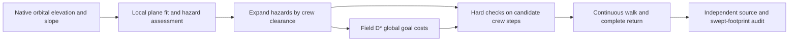

# NASA-informed crew navigation

Implemented locally on 14 November 2026 after the Phase 3 milestone. MAREKH remains a **crew-walk planner**, as requested. Its default saved routes now use an independently implemented Field D* goal field and a local crew-step planner. The Phase 3 A* routes remain intact and selectable for comparison.

This is an adaptation of the publicly described MER global/local architecture. It is not NASA flight software, a reproduction of Perseverance ENav, an implementation of ACE, or a validated human mobility model.

## What changed



NASA's MER architecture combines a global Field D* planner with local terrain assessment and short candidate motions. Its configuration-space representation expands hazards by the vehicle radius. This informed the separation of assessment, global guidance and local feasibility in MAREKH. [Carsten et al., global/local MER architecture](https://www-robotics.jpl.nasa.gov/media/documents/IEEEAC-Carsten-1125.pdf)

Field D* uses interpolated neighbour costs and repairs its solution when cell traversal costs change. Our implementation follows the uniform-grid, centre-cell-only interpolation variant described in the algorithm paper, which also discusses that variant's use for MER. [Ferguson and Stentz, Field D*](https://publications.ri.cmu.edu/storage/publications/pub_files/pub4/ferguson_david_2006_3/ferguson_david_2006_3.pdf)

Perseverance's orientation-sensitive hazard assessment addresses rover geometry and clearance. We do not transfer those vehicle-specific checks to an astronaut or label our orbital assessment as ENav/ACE. [JPL Mars 2020 mobility](https://robotics.jpl.nasa.gov/what-we-do/flight-projects/mars-2020-rover/m2020mobility/)

| Component | Implemented in MAREKH | Fidelity boundary |
| --- | --- | --- |
| Global guidance | Uniform-grid Field D*, continuous edge-cost interpolation, `g/rhs` consistency, incremental cost increases/decreases and obstacle removal | Independent implementation; no flight code, quantized cost table, bottom-cell shortcut or flight performance equivalence |
| Traversability | Native slope, manual exclusions, missing coverage, local detrended RMS roughness and maximum plane residual | Orbital-scale terrain residuals; no stereo rock detection, soil classification or measured step-height inference |
| Footprint | Conservative hazard expansion and whole-path swept circular crew clearance | Illustrative human-and-margin radius; no astronaut biomechanics, suit articulation or validated EVA limits |
| Local decisions | Hard-check short candidate steps, then combine integrated local cost, global guidance and turn preference | Crew can change heading freely; not rover steering arcs or GESTALT's exact voting implementation |
| Changing terrain | Cost-update API repairs existing Field D* state; tests compare with fresh solves | The app currently reviews static orbital routes; no live sensors or observation stream |
| Return | Reverse under static symmetric constraints; recalculate grade, climb and cost and revalidate every native piece | Does not claim an identical route would remain safe after observations or conditions change |

## Explicit crew assumptions

The complete [versioned config](../config/columbia-hills/crew-navigation-v1.json) retains source URLs, conventions and rationale. Its values are **project demo assumptions, not NASA thresholds**:

- Illustrative body radius **0.45 m**, plus **0.55 m** margin: **1.0 m effective clearance radius** along the entire walk.
- Surface warning above **10°**, hard native surface limit **20°**, staging limit **5°**, and separate absolute along-move grade limit **20°**.
- A least-squares plane is fitted to each native **3 × 3** height window. Hard limits are **0.10 m RMS** residual and **0.25 m maximum absolute** residual. Removing the plane separates roughness from a uniform slope.
- Unknown neighbourhoods, invalid heights, map boundaries, excessive residuals, steep cells and reviewed exclusions become hazards. Unknown terrain stays blocked, a deliberate conservative difference from MER's exploratory unknown-cost policy.
- Each hazard occupies its complete native cell box. Inflation blocks any candidate cell whose whole box lies within the clearance radius of a hazard box. This is more conservative than evaluating clearance at cell centres alone.

Absolute geolocation accuracy, small obstacles, loose material and operational crew suitability remain unresolved by these data. Roughness is a raster residual, not a certified measurement of rocks or soil safety. No speed, metabolic cost or travel-time model is asserted.

## Field D* and local steps

`src/routing/field-dstar.ts` owns the global field. Its nodes lie at native pixel centres; each cost square spans four centres. The interpolation backup minimizes travel through a square followed by a linearly interpolated cost on the opposing cardinal/diagonal edge. It maintains a deterministic priority queue, `g` and one-step `rhs`, and updates affected corners when a square cost changes.

The heuristic is **zero**, deliberately computing a complete reusable goal field. This is valid but less focused than flight configurations. The implementation has an explicit convergence budget and fails rather than publishing an unfinished solution. Terrain and guide state remain in projected metre coordinates; no latitude/longitude distance approximation is used.

The distance-priority global density is **1**. Terrain-priority cell density is:

```text
1 + 4 × (native slope / 20°)² + 2 × (plane RMS / 0.10 m)²
```

A cost square uses the maximum density of its four nodes. It is impassable if any corner fails clearance or either native terrain triangle exceeds the grade limit. Thus global guidance uses a conservative 2D terrain-cost field; it is not an exact minimum-3D-distance optimizer.

`src/routing/crew-planner.ts` considers **32 headings**, direct goal direction and a Field D* successor direction, using **1.0 m** and **0.5 m** step candidates. Hard terrain checks come first. Feasible candidates rank by integrated local cost plus global cost-to-go plus a **0.05 metre-equivalent per radian** turn preference. Goal cost must decrease. A stall, missing corridor or step-budget failure is explicit: no A* fallback or relaxed limit is silently applied.

This local selection is heuristic and does not guarantee a globally optimal route. Its candidate lengths and turn preference are crew-demo choices. They do not represent footfall mechanics or rover actuator constraints.

## Native geometry and independent clearance checks

The height model uses piecewise-planar interpolation over the **full native grid**, independently of the reduced display mesh. Candidate segments split exactly at native cell boundaries, interpolation patch boundaries and triangle diagonals. Each resulting piece retains projected coordinates, native height support, signed grade, crossed-cell surface slope and cumulative distance.

`tools/validate_crew_routes.py` independently:

1. Reconstructs the complete roughness/residual grids with a separate vectorized least-squares fit and verifies the hazard and inflated masks.
2. Computes native triangle heights, exact segment/closed-cell intersections, distance, signed grade, positive climb, warnings and policy cost.
3. Checks the physical swept capsule against raw hazard rectangles using segment-to-rectangle distance, independently of the inflated mask. It rejects a capsule intersection even if the inflation mask has been tampered with.
4. Checks staging/approach footprints, science turnaround, reversed native positions and closure at the original departure point.
5. Compares every referenced source height with the original HiRISE IMG.
6. Reopens the Mars-CRS GeoPackage and verifies route vertices and the areas of the exported raw-hazard and clearance-blocked polygons.

The audit passed **4,512 native pieces**, with **1,183 source cells** and **zero source-height difference**. The whole grid contains **93,766 raw hazard cells** and **112,198 clearance-blocked cells** under these assumptions. A null nearby-hazard minimum means no hazard was found inside the finite search envelope, not that the required-radius capsule check was skipped.

## Saved real-data results

| Round-trip metric | Distance priority | Terrain priority |
| --- | ---: | ---: |
| 3D native surface distance | 404.4292 m | 413.2080 m |
| Horizontal distance | 403.2193 m | 412.2540 m |
| Positive climb, both legs | 11.5628 m | 11.2238 m |
| Maximum crossed-cell surface slope | 18.8147° | 12.8982° |
| Maximum absolute travel grade | 17.1775° | 14.3080° |
| Outbound local steps | 366 | 215 |
| Outbound native points | 1,206 | 1,052 |
| Audited pieces, both legs | 2,410 | 2,102 |
| Native pieces above the surface warning | 98 | 34 |

Both global fields processed 867,358 reachable nodes. On this machine the two complete route generations took roughly **9–12 seconds each** during verification. These are offline measurements, not a performance guarantee. The page loads saved results; worker-backed interactive replanning remains Phase 4.

The shorter distance-priority result crosses steeper terrain than the preserved A* shortest route. Different global objectives, continuous headings, terrain representations and local decision rules make the numbers **non-equivalent**; this change is not a promise of uniformly safer or shorter output. The original A* round trips remain 411.3881 m / 418.5368 m with their original assumptions. Warning counts also use different segment representations, so compare the underlying geometry rather than counts alone.

## Artifacts and commands

The package is `public/sites/columbia-hills/crew-navigation-v1/`. It contains:

- `routes.json`, `mission.json`, `config.json` and `validation.json`.
- Native `roughness-rms.f32`, `residual-max.f32`, `hazard.u8` and `clearance-blocked.u8`.
- `crew-clearance.webp`, a display overlay of the derived masks.
- `route-review.gpkg`, `route-edges.csv` and the north-up optical `route-review.png`.
- `manifest.json` with byte counts, SHA-256 hashes, CRS and pinned terrain/baseline manifests.

```bash
cd /home/owais/MAREKH
export PATH="$HOME/.bun/bin:$PATH"
export COLUMBIA_GDAL_PYTHON=/usr/bin/python3
bun run generate:crew
bun run validate:crew
bun run test:crew
bun run build
```

The generator uses the preserved Phase 3 endpoint record and verifies its hash; changed endpoints require a new footprint decision. The independent validator is part of the production build. Field D* math is tested against a separate dense minimization, flat fields against analytical bounds, and incremental obstacle/cost repairs against fresh solves. Local tests include an extended obstacle detour, native interpolation, unknown/corner contact, roughness, grade limits and endpoint failure. Negative audit tests detect altered coordinates, heights, metrics and swept hazards.

The local app defaults to **NASA-informed crew planning**. Its navigation-model selector restores the Phase 3 A* comparison without changing either saved package. A separate crew-clearance overlay and mode-specific explanations distinguish the models. Both modes retain GIS/data downloads and native terrain inspection.

All **52 automated tests** passed: the previous 36, 11 new TypeScript navigation checks and five independent Python audit checks. Full source/terrain/package validation, TypeScript checking and the production build passed. The existing non-failing Three.js bundle-size advisory remains; no dependencies were added.

Browser review verified default crew results, full-route clearance display and control, the A* comparison's original metrics, its disabled crew overlay and mode-correct download targets, and restoration of the crew default on reload. The layout was also reviewed at the browser's narrower natural size. Final browser diagnostics contained no errors or warnings. The pre-existing local preview service was reused and left running; no site was published.

[Saved browser preview](nasa-crew-navigation-preview.jpg) · [North-up native route review](../public/sites/columbia-hills/crew-navigation-v1/route-review.png) · [Independent audit](../public/sites/columbia-hills/crew-navigation-v1/validation.json)

## Remaining work

Connect movable crew staging and candidate-footprint checks to a worker, show failures while preserving the last valid plan, and add the two-leg linked route profile and alerts. Persistent observation fusion, richer terrain measurements and operational crew modelling require additional inputs; they cannot be supplied by changing the search algorithm alone.

## Later grade objective

The default app now shows the separate [continuous walking-grade search with stated bounds](global-grade-planning.md), using a 500 m round-trip budget. This document preserves the earlier Field D* milestone and its original results. Both it and the A* baseline remain selectable.
